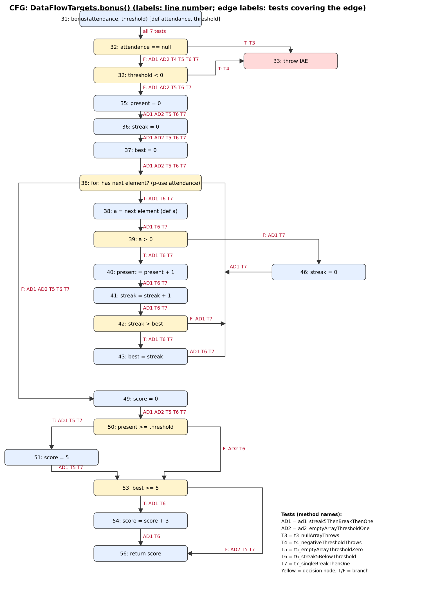

# Lab10 — Dataflow

- **Оюутны нэр:** Z.Ankhbayar
- **Оюутны код:** B232270029

## Орчин

```
$ java -version
openjdk version "25.0.5.0.3" 2026-10-24
OpenJDK Runtime Environment (build 25.0.5.0.3+1-1-26.04.1-Ubuntu)
OpenJDK 64-Bit Server VM (build 25.0.5.0.3+1-1-26.04.1-Ubuntu, mixed mode, sharing)

$ mvn -version
Apache Maven 3.9.12
Maven home: /usr/share/maven
Java version: 25.0.5.0.3, vendor: Ubuntu, runtime: /usr/lib/jvm/java-25-openjdk-amd64
Default locale: en_US, platform encoding: UTF-8
OS name: "linux", version: "7.0.0-43-generic", arch: "amd64", family: "unix"
```


## Хэсэг A: gcd — DU хосын хүснэгт

| Мөр | Код | Def | Use |
|---|---|---|---|
| 13 | `gcd(int x, int y)` | x, y | |
| 14 | `int tmp;` | (зарлага, утга оноолтгүй) | |
| 15 | `while (y != 0)` | | p-use: y |
| 16 | `tmp = x % y;` | tmp | c-use: x, y |
| 17 | `x = y;` | x | c-use: y |
| 18 | `y = tmp;` | y | c-use: tmp |
| 20 | `return x;` | | c-use: x |

Def-үүд: x@13, x@17, y@13, y@18, tmp@16.
p-use хос нь салаа (T/F) бүрээр тусдаа тоологдоно. Нийт **13 DU хос** (x: 4, y: 8, tmp: 1).

| ID | Хувьсагч | Def мөр | Use мөр | c-use/p-use | Def-clear зам | Тест | Хамрагдсан |
|---|---|---|---|---|---|---|---|
| DU1 | x | 13 | 16 | c-use | 13-15-16 | T2 | ✔ |
| DU2 | x | 13 | 20 | c-use | 13-15-20 | T1 | ✔ |
| DU3 | x | 17 | 16 | c-use | 17-18-15-16 | T2 | ✔ |
| DU4 | x | 17 | 20 | c-use | 17-18-15-20 | T2 | ✔ |
| DU5 | y | 13 | 15 (T) | p-use | 13-15 → 16 | T2 | ✔ |
| DU6 | y | 13 | 15 (F) | p-use | 13-15 → 20 | T1 | ✔ |
| DU7 | y | 13 | 16 | c-use | 13-15-16 | T2 | ✔ |
| DU8 | y | 13 | 17 | c-use | 13-15-16-17 | T2 | ✔ |
| DU9 | y | 18 | 15 (T) | p-use | 18-15 → 16 | T2 | ✔ |
| DU10 | y | 18 | 15 (F) | p-use | 18-15 → 20 | T2 | ✔ |
| DU11 | y | 18 | 16 | c-use | 18-15-16 | T2 | ✔ |
| DU12 | y | 18 | 17 | c-use | 18-15-16-17 | T2 | ✔ |
| DU13 | tmp | 16 | 18 | c-use | 16-17-18 | T2 | ✔ |


Эдгээр нь y-г `x % y`, `x = y` мөрд c-use хийж буй хосууд. Нэмж, лекцийн p-use хос (y 1→3, y 6→3) нь T/F салаа тус бүрдээ тусдаа хос болдог (DU5/DU6, DU9/DU10). Иймээс 8 + 3 = 11 хос, салаагаар тоолбол 13.

### Тестүүд (`GcdTest.java`)

| Тест | Оролт | Давталт | Хамарсан хос |
|---|---|---|---|
| T1 | gcd(7,0) | 0 | DU2, DU6 |
| T2 | gcd(12,8) | 2 | DU1, DU3, DU4, DU5, DU7–DU13 |
| T3 | gcd(0,5) | 1 | шинэ хос нэмэхгүй (регрессийн тест) |

T1 ∪ T2 = DU1…DU13 → **all-DU-pairs 13/13**.

### Асуултын хариулт

- **gcd(7,0) ганцаараа юу хамардаг вэ?** y == 0 тул давталтад огт орохгүй (зам 13-15-20). Зөвхөн **DU2: x(13→20)** ба **DU6: y(13→15, F)** хосыг хамарна. Эдгээрийг давталттай ямар ч тест хамарч чадахгүй, учир нь давталтад орвол x, y дахин тодорхойлогдоно.
- **gcd(12,8) хэдэн давталттай вэ?** **2**: (12,8) → tmp=4, x=8, y=4; (8,4) → tmp=0, x=4, y=0; дараа нь y==0 тул гарна. Үр дүн 4.
- **Давталт шаардах хосууд:** DU1, DU3, DU4, DU5, DU7–DU13 (11 хос) — бүгд 16/17/18-р мөр эсвэл давталтын дотрох def-ийг хамарна. Үүнээс дор хаяж **2 давталт** шаардах хосууд нь DU3 (x@17→16), DU9 (y@18→15 T), DU11 (y@18→16), DU12 (y@18→17): давталтын 1-р удаад тодорхойлогдсон x, y нь 2-р удаад ашиглагдана. 1 давталттай тест (жишээ нь gcd(12,4)) эдгээрийг хамарч чадахгүй.


---

## Хэсэг B: bonus — бүрэн анализ

### B1 — CFG



`cfg-bonus.png`. Зангилаа бүр файлын мөрийн дугаартай (`42: streak > best`). 32-р мөрийн `||` нь short-circuit тул хоёр зангилаа (`attendance == null`, `threshold < 0`). For-each (мөр 38) нь хоёр зангилаа: нөхцөл `has next element?` (attendance-ийн p-use) ба алхам `a = next element` (a-ийн def). Ирмэг бүрийн хажууд түүнийг дайрдаг тестийн ID-г бичсэн (ID → бодит метод нэр доорх хүснэгтэд, зургийн баруун доод буланд ч бий). Ирмэгийн хамралтыг тестийн гүйцэтгэлийг дуурайлгадаг скриптээр тооцсон.

### B2 — Def/Use жагсаалт (мөрөөр)

```
31  bonus(int[] attendance, int threshold)  // def: attendance, threshold
32  if (attendance == null                  // p-use: attendance
        || threshold < 0)                   // p-use: threshold (attendance != null үед л хүрнэ)
33  throw new IAE(...)                      //
35  int present = 0;                        // def: present
36  int streak  = 0;                        // def: streak
37  int best    = 0;                        // def: best
38  for (int a : attendance)                // p-use: attendance (дараагийн элемент байгаа эсэх); def: a (алхам)
39  if (a > 0)                              // p-use: a
40  present = present + 1;                  // def: present; c-use: present
41  streak = streak + 1;                    // def: streak;  c-use: streak
42  if (streak > best)                      // p-use: streak, best
43  best = streak;                          // def: best;    c-use: streak
46  streak = 0;                             // def: streak   (KILL: streak@36, streak@41)
49  int score = 0;                          // def: score
50  if (present >= threshold)               // p-use: present, threshold
51  score = 5;                              // def: score    (KILL: score@49)
53  if (best >= 5)                          // p-use: best
54  score = score + 3;                      // def: score;   c-use: score (KILL: score@49 эсвэл score@51)
56  return score;                           // c-use: score
```

Def-үүд: attendance@31, threshold@31, a@38, present@35/40, streak@36/41/46, best@37/43, score@49/51/54 (13 def).

### B3 — DU хүснэгт

`[…]` = тухайн мөр заавал биш (салаа). Нийт 35 хос (p-use-ийн T/F салаа тусдаа), үүнээс 2 нь биелэшгүй, **33 биелэх хос**.

| ID | Хувьсагч | Def мөр | Use мөр | Төрөл | Def-clear зам | Тестийн ID | Хамрагдсан |
|---|---|---|---|---|---|---|---|
| DU1 | attendance | 31 | 32 (T) | p-use | 31→32 | T3 | ✔ |
| DU2 | attendance | 31 | 32 (F) | p-use | 31→32→32b | AD1, AD2, T4, T5, T6, T7 | ✔ |
| DU3 | attendance | 31 | 38 (T) | p-use | 31→32→32b→35→36→37→38 | AD1, T6, T7 | ✔ |
| DU4 | attendance | 31 | 38 (F) | p-use | 31→…→37→38 | AD1, AD2, T5, T6, T7 | ✔ |
| DU5 | threshold | 31 | 32 (T) | p-use | 31→32→32b | T4 | ✔ |
| DU6 | threshold | 31 | 32 (F) | p-use | 31→32→32b | AD1, AD2, T5, T6, T7 | ✔ |
| DU7 | threshold | 31 | 50 (T) | p-use | 31→32→35→36→37→38(F)→49→50 | AD1, T5, T7 | ✔ |
| DU8 | threshold | 31 | 50 (F) | p-use | 31→32→35→36→37→38(F)→49→50 | AD2, T6 | ✔ |
| DU9 | a | 38 | 39 (T) | p-use | 38→39 | AD1, T6, T7 | ✔ |
| DU10 | a | 38 | 39 (F) | p-use | 38→39 | AD1, T7 | ✔ |
| DU11 | present | 35 | 40 | c-use | 35→36→37→38→39→40 | AD1, T6, T7 | ✔ |
| DU12 | present | 35 | 50 (T) | p-use | 35→36→37→38(F)→49→50 | T5 | ✔ |
| DU13 | present | 35 | 50 (F) | p-use | 35→36→37→38(F)→49→50 | AD2 | ✔ |
| DU14 | present | 40 | 40 | c-use | 40→41→42→[43→]38→39→40 | AD1, T6, T7 | ✔ |
| DU15 | present | 40 | 50 (T) | p-use | 40→41→42→[43→]38(F)→49→50 | AD1, T7 | ✔ |
| DU16 | present | 40 | 50 (F) | p-use | 40→41→42→[43→]38(F)→49→50 | T6 | ✔ |
| DU17 | streak | 36 | 41 | c-use | 36→37→38→39→40→41 | AD1, T6, T7 | ✔ |
| DU18 | streak | 41 | 41 | c-use | 41→42→[43→]38→39→40→41 | AD1, T6 | ✔ |
| DU19 | streak | 41 | 42 (T) | p-use | 41→42 | AD1, T6, T7 | ✔ |
| DU20 | streak | 41 | 42 (F) | p-use | 41→42 | AD1, T7 | ✔ |
| DU21 | streak | 41 | 43 | c-use | 41→42→43 | AD1, T6, T7 | ✔ |
| DU22 | streak | 46 | 41 | c-use | 46→38→39→40→41 | AD1, T7 | ✔ |
| DU23 | best | 37 | 42 (T) | p-use | 37→38→39→40→41→42 | AD1, T6, T7 | ✔ |
| DU24 | best | 37 | 42 (F) | p-use | — (def-clear зам байгаа ч биелэшгүй) | — | ✘ биелэшгүй |
| DU25 | best | 37 | 53 (T) | p-use | — (биелэшгүй) | — | ✘ биелэшгүй |
| DU26 | best | 37 | 53 (F) | p-use | 37→38(F)→49→50→[51→]53 | AD2, T5 | ✔ |
| DU27 | best | 43 | 42 (T) | p-use | 43→38→39→40→41→42 | AD1, T6 | ✔ |
| DU28 | best | 43 | 42 (F) | p-use | 43→38→39→40→41→42 | AD1, T7 | ✔ |
| DU29 | best | 43 | 53 (T) | p-use | 43→38(F)→49→50→[51→]53 | AD1, T6 | ✔ |
| DU30 | best | 43 | 53 (F) | p-use | 43→38(F)→49→50→[51→]53 | T7 | ✔ |
| DU31 | score | 49 | 54 | c-use | 49→50(F)→53(T)→54 | T6 | ✔ |
| DU32 | score | 49 | 56 | c-use | 49→50(F)→53(F)→56 | AD2 | ✔ |
| DU33 | score | 51 | 54 | c-use | 51→53(T)→54 | AD1 | ✔ |
| DU34 | score | 51 | 56 | c-use | 51→53(F)→56 | T5, T7 | ✔ |
| DU35 | score | 54 | 56 | c-use | 54→56 | AD1, T6 | ✔ |

**Kill (46-р мөрийн `streak = 0`, `else` дотор):** 46-р мөр нь `streak@36` ба `streak@41` def-үүдийг **алдаг** (kill). Иймээс 39-ийн F салаагаар дайрсан замууд (…→39(F)→46→38→…) def-clear биш. Үүний үр дүнд:
- `streak@36 → 41`, `streak@41 → 41` хосууд зөвхөн 46-г **ҮЛ дайрсан** зам дээр оршино (эхний элементээс эхлэн дараалсан ирц). DU17, DU18 нь тийм зам дээр хамрагдана.
- `streak@46 → 41` (DU22) нь тасалсны дараах эхний ирц.

**Kill-ээр тасарч, DU хос гэж ТООЛООГҮЙ хослолууд** (def-clear зам огт байхгүй):
- `streak@36 → 42`, `streak@36 → 43`: 36-аас 42/43-д хүрэх бүх зам 41 (`streak = streak + 1`)-ийг дайрч def-ийг дарна.
- `streak@46 → 42`, `streak@46 → 43`: мөн адил 46 → … → 41 → 42, 41 дахин тодорхойлно.
- `streak@41 → 41` бол 46-аар (else-ээр) дамжвал kill-д тасарна; зөвхөн дараалсан ирцийн зам (39 T → 40 → 41) def-clear тул хос хэвээр.
- `score@49 → 54/56` зам 51-ийг дайрвал тасарна; 50(F) замаар 51-ийг алгасвал def-clear тул хос хэвээр (DU31, DU32). `score@51 → 56` 54-ийг алгасвал (DU34).

**Биелэшгүй хосууд (def-clear зам CFG-д байгаа ч гүйцэтгэгдэх оролт байхгүй):**
- **DU24** `best@37 → 42 (F)`: 42-д анх хүрэх үед `streak ≥ 1` (41-д дөнгөж нэмсэн), `best = 0` тул `streak > best` үргэлж үнэн; F салаа боломжгүй.
- **DU25** `best@37 → 53 (T)`: 37-ийн def 53 хүртэл амьд байвал 43 хэзээ ч ажиллаагүй, өөрөөр хэлбэл `best` 0 хэвээр тул `best >= 5` үргэлж худал; T салаа боломжгүй.

(Хоёуланг нь урт ≤ 8, элемент {0,1,2}, threshold −1…10 бүх оролтыг шавхан шалгаж баталгаажуулсан.)

### B4 — Тестүүд (`BonusTest.java`)

| ID | Метод | Оролт | Үр дүн |
|---|---|---|---|
| AD1 | `ad1_streak5ThenBreakThenOne` | `{1,1,1,1,1,0,1}`, 3 | 8 |
| AD2 | `ad2_emptyArrayThresholdOne` | `{}`, 1 | 0 |
| T3 | `t3_nullArrayThrows` | `null`, 0 | IAE |
| T4 | `t4_negativeThresholdThrows` | `{}`, −1 | IAE |
| T5 | `t5_emptyArrayThresholdZero` | `{}`, 0 | 5 |
| T6 | `t6_streak5BelowThreshold` | `{1,1,1,1,1}`, 6 | 3 |
| T7 | `t7_singleBreakThenOne` | `{1,0,1}`, 1 | 5 |
| T8 | `t8_streak4AfterBreakStaysBelow5` | `{1,0,1,1,1,1}`, 1 | 5 |

**Шат 1 — ALL-DEFS: AD1 + AD2 (2 тест).**

*Яагаад 2-оос цөөн болохгүй вэ:* `score`-ийн 3 def (49, 51, 54) бүр заавал use-д хүрэх ёстой. Нэг гүйцэтгэлд `score@49` ба `score@51` хоёрыг хоёуланг нь use-д хүргэх боломжгүй: 51 ажиллавал 50→51 дээр `score@49`-ийг дарж, 49-ийн def ямар ч use-д хүрэхээс өмнө алдагдана; 51 ажиллахгүй бол `score@51` огт үүсэхгүй. Тиймээс `score@49` (50-ийн F салаа: DU31/DU32) ба `score@51` (50-ийн T салаа: DU33/DU34) өөр өөр гүйцэтгэл шаарддаг → хамгийн багадаа **2 тест**. 2 тест хангалттай: AD1 (50 T, 53 T) нь `score@51 → 54`, `score@54 → 56` болон бусад бүх def-ийг, AD2 нь `score@49 → 56`-г хамарна.

ALL-DEFS-ээр хамрагдсан хос: DU2, DU3, DU4, DU6, DU7, DU8, DU9, DU10, DU11, DU13, DU14, DU15, DU17, DU18, DU19, DU20, DU21, DU22, DU23, DU26, DU27, DU28, DU29, DU32, DU33, DU35 (26/33).

**Шат 2 — ALL-DU-PAIRS: AD1, AD2 + T3…T7 (нийт 7 тест).** Биелэх 33 хос бүгд хамрагдсан (дээрх хүснэгтийн «Тестийн ID» багана).

### B5 — JaCoCo

| Файл | BRANCH_MISSED | BRANCH_COVERED | LINE_MISSED | LINE_COVERED |
|---|---|---|---|---|
| `results/jacoco-alldefs.csv` (AD1+AD2+gcd тестүүд) | 2 | 14 | 2 | 22 |
| `results/jacoco-branch100-partial.csv` (AD1, AD2, T3, T4 + GcdTest) | 0 | 16 | 1 | 23 |
| `results/jacoco-final.csv` (бүх тест) | **0** | **16** | 1 | 23 |

`LINE_MISSED = 1` нь 7-р мөрийн далд constructor (`DataFlowTargets()`); хамруулах гэж өөрчлөөгүй.

- **All-defs хангасан ч branch 100% биш байж болох уу? Тийм.** `jacoco-alldefs.csv`: Branch 14/16 (2 missed). AD1, AD2 нь бүх def-ийг use-д хүргэсэн ч 32-р мөрийн `attendance == null`-ийн T ба `threshold < 0`-ийн T салаа (IAE шидэх) хамрагдаагүй. All-defs нь branch-ийг заавал хамарна гэсэн баталгаа биш.
- **Branch 100% болсон ч DU хос үлдэж болох уу? Тийм — лекцийн гол баталгаа.** AD1, AD2, T3, T4 (4 тест) нь `jacoco-branch100-partial.csv`-д BRANCH_MISSED = 0 (16/16) өгдөг. Гэвч DU хосоос **5 нь хамрагдаагүй**: DU12 (`present@35 → 50 T`), DU16 (`present@40 → 50 F`), DU30 (`best@43 → 53 F`), DU31 (`score@49 → 54`), DU34 (`score@51 → 56`). Жишээ нь DU31: `present < threshold`, гэхдээ `best >= 5` — T6 (`{1,1,1,1,1}`, 6) шиг оролт хэрэгтэй; branch тус бүр нь өөр өөр тестээр хамрагдсан ч салааны **хослол** (50 F → 53 T) хэзээ ч нэг гүйцэтгэлд тохиолдоогүй. DU хос нь салаануудын хоорондын өгөгдлийн урсгалыг шаарддаг тул branch хамралтаас хүчтэй.

Нийт хамралт: 11 тест (GcdTest 3 + BonusTest 8), бүгд ногоон: `results/mvn-verify-final.txt`.

---

## Хэсэг C: Fault seeding — урсгалын алдаа

Мутацийг `DataFlowTargets.java` дээр шууд хийж, `mvn test` ажиллуулсны дараа `git restore`-оор буцаасан (commit хийгээгүй). Гаралтууд: `results/mvn-test-M1.txt`, `M2.txt`, `M2-kill.txt`, `M3.txt`.

| № | Мутаци | Төрөл | Үр дүн | Унасан тест (expected / was) |
|---|---|---|---|---|
| M1 | 41-р мөр `streak = streak + 1;`-ийг устгав | Missing update (дутуу def) | **Баригдсан** (2 тест унав) | `BonusTest.ad1_streak5ThenBreakThenOne:20 expected: <8> but was: <5>`; `BonusTest.t6_streak5BelowThreshold:50 expected: <3> but was: <0>` |
| M2 | 43-р мөр `best = streak;` → `best = present;` | Wrong variable (буруу use) | **АМЬД үлдсэн** (10/10 ногоон) | — (7 BonusTest + 3 GcdTest бүгд өнгөрсөн) |
| M2 + T8 | M2 хэвээр, `t8_streak4AfterBreakStaysBelow5` нэмсэн | | **Баригдсан** | `BonusTest.t8_streak4AfterBreakStaysBelow5:62 expected: <5> but was: <8>` |
| M3 | Давталтын дараа `int total = present + best;` нэмэв (хэрэглэгдэхгүй) | Dead definition (үхсэн def) | **АМЬД үлдсэн** (BUILD SUCCESS, 10/10) | — |

### M1 — яагаад баригдсан бэ
`streak` хэзээ ч нэмэгдэхгүй тул 42-р мөрийн `streak > best` үргэлж худал, `best` 0 хэвээр. `score`-ийн 53-р мөрийн `best >= 5` салаа шийдвэрлэх тестүүд (AD1: 8 хүлээсэн, 5 гарсан; T6: 3 хүлээсэн, 0 гарсан) унав. DU хос `streak@41 → 43`, `streak@41 → 42` (DU19–21) хамрагдсан тул алдаа гарах нь дамжиггүй: def устсан тул use нь утга өөрчлөгдсөнийг мэдэрнэ.

### M2 — бүх DU хос хамрагдсан атал яагаад баригдсангүй вэ
Мутаци `best = streak` → `best = present` нь DU хосын бүтцийг **өөрчилдөг**: `streak@41 → 43` (DU21) c-use алга болж, оронд нь `present → 43` гэсэн шинэ use үүснэ. Гэвч 43-р мөр бол `best`-ийг шинэчлэх мөч бөгөөд тэр үед `present` ба `streak`-ийн утга **ижил**: бидний бүх тестэд `best` нь эхний тасралтаас өмнө, `present == streak` үед л шинэчлэгдсэн.
- AD1 `{1,1,1,1,1,0,1}`: `best` 1…5 болон шинэчлэгдэх үед `present = streak` (1…5). Тасралтын дараах `1` нь `streak = 1 > best = 5` биш тул `best` шинэчлэгдэхгүй.
- T6 `{1,1,1,1,1}`, T7 `{1,0,1}`: мөн адил.

Бүх DU хос (өгөгдлийн урсгалын ирмэг) хамрагдсан боловч DU хамралт нь use дээр **ямар утга** байсныг шалгадаггүй: `streak` ба `present` хоёр өөр хувьсагч атал тестүүдэд адил утгатай байсан тул буруу хувьсагч хэрэглэсэн нь ялгарсангүй.

**Баригдсан тест (T8):** `bonus({1,0,1,1,1,1}, 1)`, хүлээгдэх 5. Тасралтын дараа `present > streak` болдог: `streak = 2` үед `present = 3`, дараа нь `streak = 4` үед `present = 5` тул мутаци `best = 5` болгож `best >= 5` (53)-ыг худал-аас үнэн болгоно → 8 гарна (унасан: `expected: <5> but was: <8>`). Жинхэнэ код: хамгийн урт цуваа 4 → 5 оноо. T8-г нэмсний дараа мутаци M2 баригдана.

### M3 — яагаад ямар ч тест унагадаггүй вэ, юу барих вэ
`total` нь хэрэглэгддэггүй (dead definition) тул гаралт, салаа, `score` бүгд өөрчлөгдөхгүй: ажиллах үеийн ямар ч ажиглагдах үр нөлөөгүй. Тест нь зөвхөн тооцоолсон утгыг шалгадаг тул үхсэн def-ийг оношлох боломжгүй. `javac -Xlint:all`-ийг мөн ажиллуулж үзсэн: **анхааруулга огт гаргаагүй**, compile амжилттай.

Барих хэрэгсэл — **static analysis** (Лекц 10: def-use анализ дээр суурилсан "def байна, use байхгүй" илрүүлэлт): IDE-ийн inspection (IntelliJ IDEA-д "Variable 'total' is never used" / "unused variable"), мөн SpotBugs, PMD (`UnusedLocalVariable`), SonarQube. Динамик тест биш статик анализ нь dead def-ийг илрүүлдэг.

### Эцсийн төлөв
`git status`-д `DataFlowTargets.java` өөрчлөгдөөгүй. Эцсийн гаралт: `results/mvn-verify-final.txt`, `results/jacoco-final.csv` (BRANCH_MISSED = 0, 16/16; LINE_MISSED = 1 — 7-р мөрийн далд constructor). T8 нэмсний дараа тест 11 (BonusTest 8 + GcdTest 3), бүгд ногоон.

---

## Дүгнэлт

Branch хамралт нь салаа бүрийг хоёр чиглэлд нь нэг удаа дайрсан эсэхийг л хэмждэг бол DU анализ нь def-ээс use хүртэлх өгөгдлийн урсгалыг шалгадаг тул илүү хүчтэй. Үүнийг `AD1, AD2, T3, T4` багц харуулсан: branch 16/16 хамрагдсан боловч 33 биелэх DU хосын 5 нь (DU12, DU16, DU30, DU31, DU34) хамрагдаагүй байсан. M1 (def устсан)-ийг DU хос дээр суурилсан тестүүд барьсан, харин M2 (буруу хувьсагч)-ийг бүх DU хос хамрагдсан ч барьж чадаагүй: DU хамралт use дээрх утгыг биш, зөвхөн def-use холбоог шалгадаг тул `present` ба `streak` ижил утгатай байхад ялгарсангүй. M3 (үхсэн def)-ийг ямар ч тест барьдаггүй, static analysis л барина. DU анализ нь үнэтэй: bonus() дээр 35 хос (2 нь биелэшгүй), kill-ийг гараар задлах, def-clear зам олох, биелэшгүй хосыг батлах шаардлагатай, тэгсэн ч тест 7 болсон (branch-д 4 хангалттай байсан). Хамгийн их цаг авсан алхам нь B хэсэг, тухайлбал bonus()-ийн DU хос бүрийн def-clear зам, kill, биелэшгүй хосыг шалгаж хүснэгтэлсэн ба CFG зурсан ажил байсан. Практикт branch хамралтыг суурь болгож, чухал урсгалд DU хос, мутацийн шалгалт, static analysis-ийг нэмэх нь зөв.

